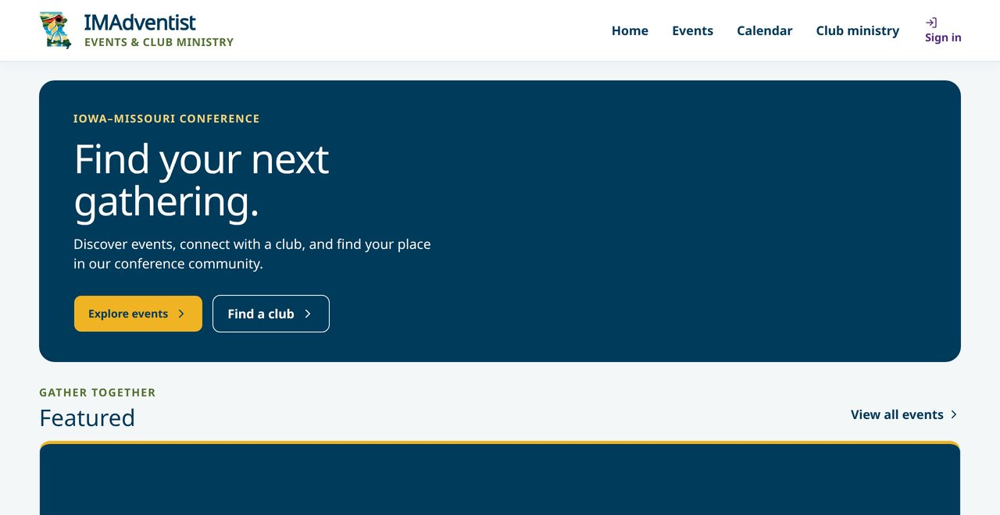
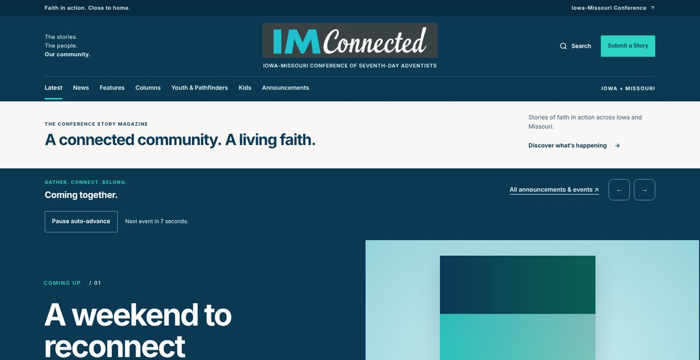

<!-- Header banner -->

  

<!-- Animated tagline -->

  

<!-- Quick links -->

  
  
  
  

---

## 👋 About me

I'm the **Director of Communication** for the **Iowa-Missouri Conference of Seventh-day Adventists**, serving **13,000+ members** across Iowa and Missouri. I bring **10+ years** of experience helping nonprofit and higher-education organizations communicate across web, print, email, social media, and live events.

<table>
  <tr>
    <td align="center" width="33%">🏗️ <b>Systems builder</b> Building new systems rather than patching old ones</td>
    <td align="center" width="33%">👨‍👩‍👧‍👦 <b>Every generation</b> Reaching multi-generational audiences where they are</td>
    <td align="center" width="33%">🛠️ <b>Tech + strategy</b> WordPress, Apps Script, CRM, and livestreaming, paired with strategic vision</td>
  </tr>
</table>

## 📊 Impact at a glance

<table>
  <tr>
    <td align="center" width="25%"><h2>+200%</h2>Website engagement after redesign</td>
    <td align="center" width="25%"><h2>13K+</h2>Members served through multi-state communications</td>
    <td align="center" width="25%"><h2>5K+</h2>Participants reached in person and by livestream</td>
    <td align="center" width="25%"><h2>$13.8K</h2>Annual savings from vendor and process changes</td>
  </tr>
</table>

## ⭐ Flagship builds

<table>
  <tr>
    <td width="50%" valign="top">
      
      <h3>⛺ <a href="https://github.com/DurantTL/IMSDA-Events">IMAdventist: Events & Club Ministry</a></h3>
      Iowa-Missouri Conference · <a href="https://events.imsda.org">events.imsda.org</a>
      
One place to find events, register a family or a whole club, run check-in, and keep Pathfinder and Adventurer club records up to date.

      <ul>
        <li>Household and club registration with live pricing, promo codes, waitlists, and Square payments</li>
        <li>Club portal for rosters, forms, Monthly Records, honors, and the Year-End Report</li>
        <li>Coordinator dashboards, a no-code form builder, and QR check-in with an offline-safe queue</li>
        <li>Built to protect young people's records: server-side permissions, two-step sign-in, and encrypted data</li>
      </ul>
      
      
      
      
      
      
    </td>
    <td width="50%" valign="top">
      
      <h3>📰 <a href="https://github.com/DurantTL/IMConnected">IMConnected: Stories of Faith in Action</a></h3>
      Iowa-Missouri Conference · <a href="https://stories.imadventist.org">stories.imadventist.org</a>
      
The conference's online story magazine. Church members send in stories, editors review and publish them from one dashboard, and published stories feed the IMConnected newsletter.

      <ul>
        <li>Magazine front page with sections, newsletter issues, announcements, search, and RSS</li>
        <li>Story submission form for church members, with photo uploads and spam protection</li>
        <li>Editor dashboard with a drag-and-drop story builder, autosave, version history, and scheduled publishing</li>
        <li>Every story is reviewed by a person before it reaches the public site</li>
      </ul>
      
      
      
      
    </td>
  </tr>
</table>

## 🚀 More projects

<table>
  <tr>
    <td width="50%" valign="top">
      <h3>📝 Camporee 2026 Registration System</h3>
      IMSDA · 2025–2026  
      
      
      
    </td>
    <td width="50%" valign="top">
      <h3>🌱 Camp Meeting 2026: "Rooted Together"</h3>
      IMSDA · 2026  
      Photography · video · live AV · promotional design
    </td>
  </tr>
  <tr>
    <td width="50%" valign="top">
      <h3>🌐 Multi-State Nonprofit Website Rebuild</h3>
      Iowa-Missouri Conference  
      
      Content strategy · analytics
    </td>
    <td width="50%" valign="top">
      <h3>🎨 Brand System</h3>
      Web · print · social · live events  
      Adobe Creative Suite · brand governance · templates
    </td>
  </tr>
  <tr>
    <td width="50%" valign="top">
      <h3>📰 IM Connected</h3>
      Conference communications · ongoing  
      The conference's twice-monthly newsletter
    </td>
    <td width="50%" valign="top">
      <h3>🎥 Live Event Production</h3>
      Nevada SDA dual PTZ camera system (2025) · SWAU basketball broadcasts · SWAU Graduation 2020  
      Live direction · multi-camera · livestreaming
    </td>
  </tr>
</table>

## 🧰 Toolbox

  
  
  
  
  
  
  

**Expertise:** Communications Strategy · Brand Management · Digital Content & Web Strategy · Audience Engagement · Leadership & Internal Communications · Email Marketing & CRM · Social Media · Event Communications & Livestreaming · Analytics & Reporting

## 💼 Experience

| Years | Role | Organization |
| :-- | :-- | :-- |
| **2023–Present** | **Director of Communication** | **Iowa-Missouri Conference** |
| 2019–2023 | Event & Streaming Specialist | Mango Alto Productions |
| 2018–2023 | Media Services Manager | Southwestern Adventist University |
| 2017–2018 | Designer / IT Technician | Perciselink |
| 2014–2017 | GLOW Coordinator / Community Outreach | Arizona Conference |
| 2009–2014 | Video Editor / Film Production | The Beehive International |
| 2008–2017 | Founder & Web Designer | Geo Trek Web Design |

<b>Highlights from the Iowa-Missouri Conference</b>

 

- Led a website redesign and content restructure that increased engagement by 200%
- Built a brand system spanning digital, print, social media, and live events
- Modernized an annual calendar mailed to 2,500+ households
- Automated registration, reporting, and internal workflows
- Advised leadership during organizational change, with vendor and process changes saving about $13,800 a year
- Produced event communications reaching 5,000+ people in person and online

## 🎓 Education and certification

- **B.A. in Communications, Radio, Television & Film**, Southwestern Adventist University
   Yearbook Editor · VP of Publications, Student Association · VP of Publications, Adventist Intercollegiate Association · Student Photographer
- **Q-SYS Level 1** audiovisual certification

## 🙌 Community and service

- 🎛️ More than 20 years running audiovisual (AV) production for churches
- 🎬 Camera work for ARME Bible Camp and Secrets Unsealed
- 🌏 Student missionary to Nepal

---

  <i>"Let your light so shine before men, that they may see your good works, and glorify your Father which is in heaven."</i> 
  Matthew 5:16, KJV

<!-- Footer banner -->

  

